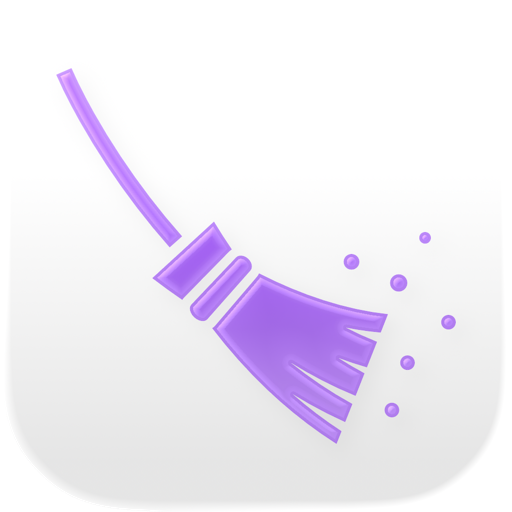
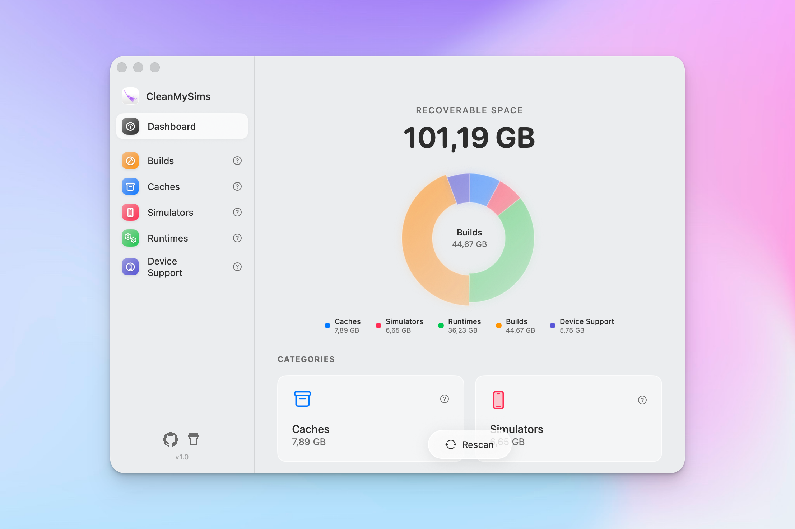

<p align="center">
  
</p>

<h1 align="center">CleanMySims</h1>

<p align="center">
  
</p>

<p align="center">
  <strong>A beautiful native macOS app to reclaim disk space from Xcode development artifacts</strong>
</p>

<p align="center">
  <a href="#features">Features</a> •
  <a href="#installation">Installation</a> •
  <a href="#usage">Usage</a> •
  <a href="#requirements">Requirements</a> •
  <a href="#building-from-source">Building from Source</a> •
  <a href="#license">License</a>
</p>

---

## Overview

**CleanMySims** is a native macOS application built with SwiftUI that helps developers reclaim disk space by cleaning up Xcode-related development artifacts. It provides a beautiful, user-friendly interface to scan, visualize, and delete various types of developer cache and simulator data.

If you're an iOS/macOS developer, you know how quickly Xcode can consume disk space with simulators, derived data, caches, and device support files. CleanMySims gives you a clear overview of what's taking up space and lets you safely clean it up with just a few clicks.

## Features

### Dashboard Overview

- **Total recoverable space** displayed prominently at the top
- **Interactive pie chart** showing space distribution by category
- **Category cards** with item counts and sizes for quick overview
- **One-click rescan** to refresh disk usage data

### Smart Scanning

Scans 5 categories of Xcode-related files simultaneously:

| Category           | Description                                                                               |
| ------------------ | ----------------------------------------------------------------------------------------- |
| **Builds**         | DerivedData from Xcode compilation, including app builds and Flutter/React Native runners |
| **Caches**         | Temporary simulator data: logs, compilation caches, downloaded data                       |
| **Simulators**     | Virtual iOS devices used by Xcode to test apps                                            |
| **Runtimes**       | iOS versions installed to run the simulators                                              |
| **Device Support** | Support files to connect physical iPhone/iPad to Xcode                                    |

### Detailed Category Views

- **Sortable lists** by name, size ascending, or size descending
- **Build items grouped by type** (Apps, Flutter/Runners, Xcode Caches)
- **App icons displayed** for build artifacts when available
- **File paths visible** for each item
- **Reveal in Finder** option to inspect files before deleting

### Safe Deletion

- **Confirmation dialogs** before any deletion
- **Items moved to trash** (not permanently deleted) for most categories
- **Simulators properly deleted** via `xcrun simctl delete` to avoid corruption
- **Non-destructive by default** - you choose what to delete

### Beautiful Native UI

- Modern **SwiftUI design** with translucent materials
- **Custom vibrant color scheme** per category
- **Smooth animations** and hover effects
- **Loading overlays** during scan/clean operations
- Native macOS look and feel

## Installation

### Download Release

Download the latest release from the [Releases](https://github.com/amstagu/CleanMySims/releases) page:

- **CleanMySims.app** - Ready-to-use application, just drag to your Applications folder
- **Source archive** - For building from source

## Requirements

- **macOS 14.0** (Sonoma) or later
- **Xcode** (for the app to have something to clean!)

## Usage

1. **Launch CleanMySims**
2. The app will automatically scan your system for Xcode-related files
3. View the **dashboard** to see total recoverable space and distribution
4. Click on any **category card** to see detailed items
5. **Select items** you want to delete or use "Select All"
6. Click **Delete Selected** and confirm
7. Items are moved to trash (except simulators which are deleted via simctl)

### Keyboard Shortcuts

| Shortcut  | Action                      |
| --------- | --------------------------- |
| `Cmd + R` | Rescan all categories       |
| `Cmd + F` | Focus search in detail view |
| `Delete`  | Delete selected items       |

## Building from Source

### Prerequisites

- Xcode 15.0 or later
- macOS 14.0 (Sonoma) or later

### Steps

1. **Clone the repository**

```bash
git clone https://github.com/amstagu/CleanMySims.git
cd CleanMySims
```

2. **Open in Xcode**

```bash
open CleanMySims.xcodeproj
```

3. **Build and run**

- Select the `CleanMySims` scheme
- Press `Cmd + R` to build and run

### Command Line Build

```bash
xcodebuild -project CleanMySims.xcodeproj \
  -scheme CleanMySims \
  -configuration Release \
  -derivedDataPath build
```

The built app will be in `build/Build/Products/Release/CleanMySims.app`.

## Architecture

```
CleanMySims/
├── CleanMySimsApp.swift          # App entry point
├── ContentView.swift             # Main layout with navigation
├── Models/
│   └── CleanableItem.swift       # Data models
├── Logic/
│   ├── SimulatorManager.swift    # Core business logic
│   ├── Shell.swift               # Shell command execution
│   └── IconThumbnailCache.swift  # Icon caching system
├── Views/
│   ├── Theme.swift               # Colors, fonts, layout constants
│   ├── SidebarView.swift         # Navigation sidebar
│   ├── DashboardView.swift       # Main dashboard
│   ├── DetailListView.swift      # Category detail views
│   └── Components/               # Reusable UI components
└── Assets.xcassets/              # App icons and images
```

### Technologies Used

- **SwiftUI** - Modern declarative UI framework
- **Combine** - Reactive programming for state management
- **FileManager** - File system operations and size calculations
- **xcrun simctl** - Simulator management via CLI
- **Grand Central Dispatch** - Background threading for smooth UI

## Privacy

CleanMySims:

- **Does not collect any data**
- **Does not connect to the internet**
- **Does not have analytics or tracking**
- **Works entirely offline**

All operations are performed locally on your machine.

## Contributing

Contributions are welcome! Please feel free to submit a Pull Request.

1. Fork the repository
2. Create your feature branch (`git checkout -b feature/AmazingFeature`)
3. Commit your changes (`git commit -m 'Add some AmazingFeature'`)
4. Push to the branch (`git push origin feature/AmazingFeature`)
5. Open a Pull Request

## License

This project is licensed under the MIT License - see the [LICENSE](LICENSE) file for details.

## Acknowledgments

- Inspired by the need for a simple, beautiful tool to manage Xcode disk usage
- Built with love using SwiftUI and modern macOS technologies

---

<p align="center">
  Made with ❤️ by <a href="https://github.com/amstagu">AMSTAGU</a>
</p>
