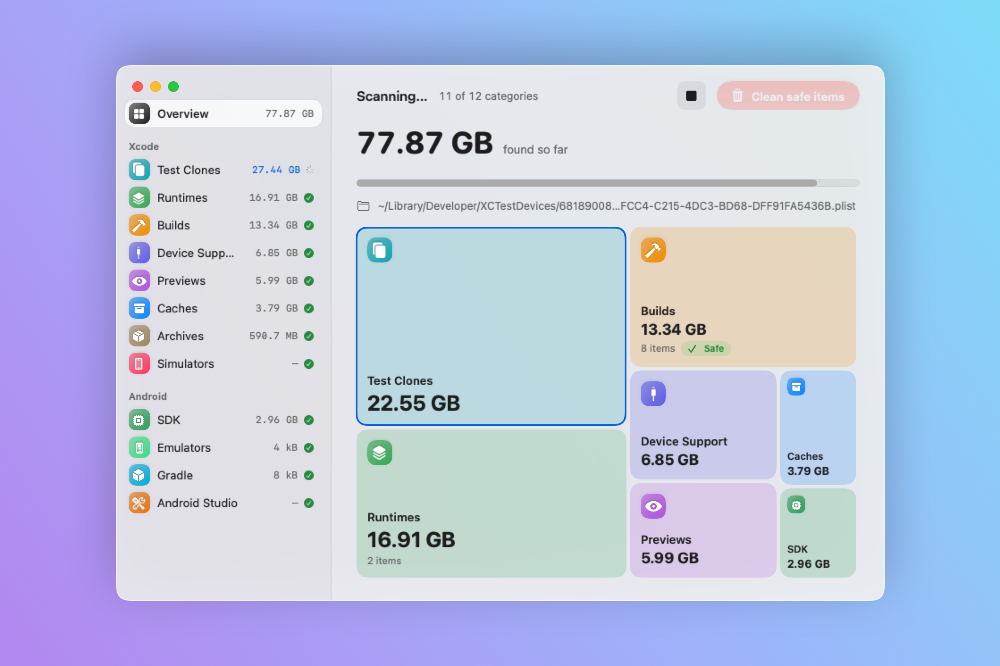
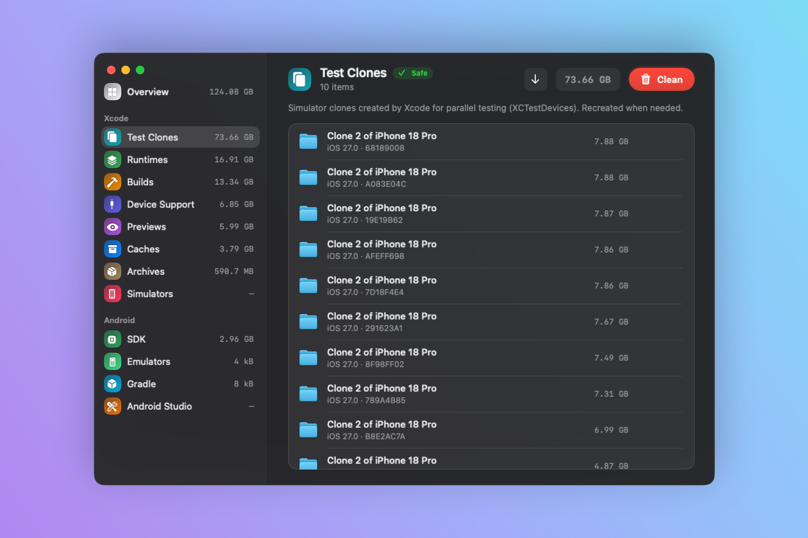

<p align="center">
  
</p>

<h1 align="center">CleanMySims</h1>

<p align="center">
  <strong>Reclaim the disk space Xcode and Android Studio quietly eat</strong>
</p>

<p align="center">
  <a href="#features">Features</a> •
  <a href="#installation">Installation</a> •
  <a href="#usage">Usage</a> •
  <a href="#how-items-are-removed">How items are removed</a> •
  <a href="#building-from-source">Building from Source</a> •
  <a href="#license">License</a>
</p>

<p align="center">
  <picture>
    <source media="(prefers-color-scheme: dark)" srcset="docs/images/preview-dark.png">
    
  </picture>
</p>

---

## Overview

**CleanMySims** is a native macOS app that finds what Xcode and Android tooling leave on your disk: simulator clones from parallel testing, old runtimes, DerivedData, device symbols, SwiftUI preview simulators, emulators, Gradle caches… It shows how much each one takes, tells you what is safe to delete, and removes it with the same tools Xcode and Android Studio use.

## Features

### Overview at a glance

- **Total recoverable space**, next to the free space left on your Mac
- **Treemap** of every category: each tile's area is proportional to its size; click one to see what's inside
- **Clean safe items** in one click: everything the tools recreate on their own (test clones, previews, caches, builds, Gradle and Android Studio caches)
- **Light and dark mode**, following the system or forced from View › Appearance

### Live scan

<p align="center">
  
</p>

- All categories are scanned **in parallel**
- The total counts up as files are measured, with the folder being read right now
- The sidebar turns into a checklist and treemap tiles grow in place as sizes come in
- Sizes are the **space actually used on disk**, not the logical file size

### Every item, one click away

<p align="center">
  
</p>

- Sort by size or name, reveal any item in Finder, delete one item or the whole category
- DerivedData is grouped into apps (with their icons), Flutter / React Native runners and Xcode caches

### Categories

| Category           | What it is                                                                         | Safe |
| ------------------ | ---------------------------------------------------------------------------------- | :--: |
| **Test Clones**    | Simulator clones created by Xcode for parallel testing (`XCTestDevices`)           |  ✓   |
| **Runtimes**       | Simulator OS versions                                                              |      |
| **Builds**         | DerivedData                                                                        |  ✓   |
| **Device Support** | Symbols for the iOS, watchOS, tvOS and visionOS devices you plugged in             |      |
| **Previews**       | Simulators used by SwiftUI previews                                                |  ✓   |
| **Caches**         | Simulator system caches (dyld shared caches) and Xcode's own cache                 |  ✓   |
| **Archives**       | `.xcarchive` bundles from Product › Archive (they hold the dSYMs for crash reports) |      |
| **Simulators**     | Simulators listed in Xcode                                                         |      |
| **Android SDK**    | Platforms, build tools and system images                                           |      |
| **Emulators**      | Android virtual devices, including leftovers Android Studio shows as broken        |      |
| **Gradle**         | Gradle caches and wrapper distributions                                            |  ✓   |
| **Android Studio** | Android Studio caches and indexes                                                  |  ✓   |

**Safe** means the tools recreate the data when they need it: deleting it never loses work.

## How items are removed

CleanMySims uses the tool that owns each item, so Xcode and Android Studio stay consistent:

| Category                           | Removed with                                                      |
| ---------------------------------- | ----------------------------------------------------------------- |
| Simulators, Test Clones, Previews  | `xcrun simctl shutdown` then `xcrun simctl delete` (in their device set) |
| Runtimes                           | `xcrun simctl runtime delete`                                     |
| Simulator system caches            | `xcrun simctl runtime dyld_shared_cache remove`                   |
| Emulators                          | `avdmanager delete avd`, then the leftover `.avd` / `.ini` files  |
| Android SDK                        | `sdkmanager --uninstall` (Trash if sdkmanager isn't installed)    |
| Builds, Xcode cache, Gradle, Android Studio | Deleted permanently: the tools rebuild them               |
| Device Support, Archives           | Moved to the Trash, so you can still get them back                |

Everything asks for confirmation first. If an item can't be removed (a simulator in use, a permission issue…), it stays listed and CleanMySims tells you why.

## Installation

Download the latest version from the [Releases](https://github.com/amstagu/CleanMySims/releases) page and drag **CleanMySims.app** to your Applications folder.

## Requirements

- **macOS 26** (Tahoe) or later
- **Xcode** and/or **Android Studio**, for the app to have something to clean

## Usage

1. **Launch CleanMySims**: the scan starts on its own
2. Look at the **treemap** to see what takes the most space
3. Click **Clean safe items**, or open a category to pick what to delete
4. Hover a row to **reveal it in Finder** or **delete** it, or use **Clean** to empty the whole category

### Keyboard Shortcuts

| Shortcut  | Action                |
| --------- | --------------------- |
| `Cmd + R` | Rescan all categories |
| `Esc`     | Stop the running scan |

## Building from Source

### Prerequisites

- Xcode 26 or later
- macOS 26 (Tahoe) or later

### Steps

```bash
git clone https://github.com/amstagu/CleanMySims.git
cd CleanMySims
open CleanMySims.xcodeproj
```

Select the `CleanMySims` scheme and press `Cmd + R`.

### Command Line Build

```bash
xcodebuild -project CleanMySims.xcodeproj \
  -scheme CleanMySims \
  -configuration Release \
  -derivedDataPath build
```

The app is built to `build/Build/Products/Release/CleanMySims.app`.

## Architecture

```
CleanMySims/
├── CleanMySimsApp.swift          # App entry point, menus (Rescan, Appearance)
├── ContentView.swift             # Sidebar + detail layout, cleaning overlay and errors
├── Models/
│   └── CleanableItem.swift       # Categories and items
├── Logic/
│   ├── DiskScanner.swift         # Finds and measures items, removes them with the right tool
│   ├── SimulatorManager.swift    # Observable state: parallel scan, progress, cleaning
│   ├── Shell.swift               # Runs xcrun simctl, avdmanager, sdkmanager
│   └── IconThumbnailCache.swift  # App and file icons
└── Views/
    ├── Theme.swift               # Light/dark color tokens, appearance
    ├── SidebarView.swift         # Categories with sizes, scan checklist
    ├── OverviewView.swift        # Total, treemap, clean safe items
    ├── DetailListView.swift      # Items of one category
    └── Components/               # TreemapView, CategoryIcon, header controls, AsyncIconView
```

### Technologies Used

- **SwiftUI** and **Observation**
- **Swift concurrency**: one task per category, progress streamed with `AsyncStream`
- **FileManager** allocated sizes for real disk usage
- **xcrun simctl**, **avdmanager** and **sdkmanager** for removal

## Privacy

CleanMySims:

- **Does not collect any data**
- **Does not connect to the internet**
- **Has no analytics or tracking**
- **Works entirely offline**

Everything happens locally on your Mac.

## Contributing

Contributions are welcome! Feel free to open an issue or a pull request.

1. Fork the repository
2. Create your feature branch (`git checkout -b feature/AmazingFeature`)
3. Commit your changes (`git commit -m 'Add some AmazingFeature'`)
4. Push to the branch (`git push origin feature/AmazingFeature`)
5. Open a Pull Request

## License

This project is licensed under the MIT License.

---

<p align="center">
  Made with ❤️ by <a href="https://github.com/amstagu">AMSTAGU</a>
</p>
